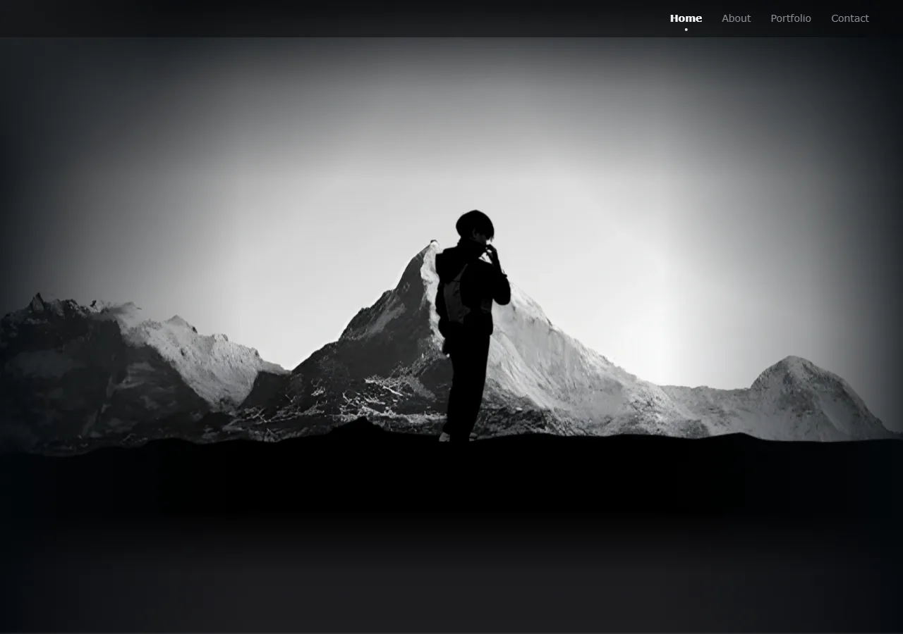
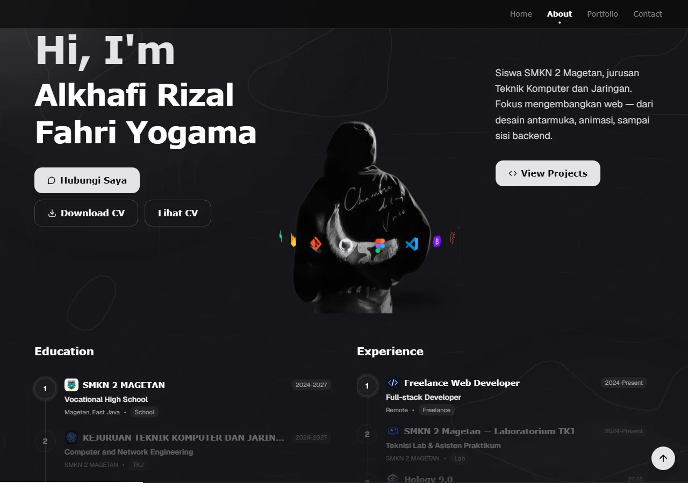
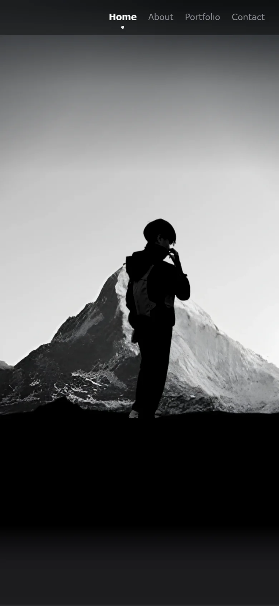

<div align="center">

# Portofolio — reyzdev

**Website portofolio pribadi** · Next.js (static export) + Cloudflare Workers

[](https://reyzdev.my.id)
[](https://nextjs.org)


</div>

> Repo ini **cuma showcase** — kode sumbernya privat. Isinya tampilan, fitur, dan stack.

## Tampilan

<div align="center">



| Desktop (About) | Mobile |
|---|---|
|  |  |

</div>

## Fitur

- **Hero animasi** — parallax berlapis, dipakai di desktop & mobile
- **Timeline pendidikan & pengalaman** yang interaktif
- **Kartu proyek** dengan lightbox detail + tab Sertifikat & Tech Stack
- **Folder interaktif** yang bisa dibuka (lihat detail proyek/kegiatan)
- **Kolom komentar** (nama, isi, foto profil opsional) tersimpan di browser
- **Form kontak** + tombol salin email + tombol kirim ke WhatsApp
- **`/cv/`** menampilkan CV (PDF) langsung di browser, plus tombol download
- SEO: metadata, Open Graph image, JSON-LD, `robots.txt`, `sitemap.xml`

## Stack

| Bagian | Teknologi |
|---|---|
| Framework | Next.js 16 (App Router, `output: "export"`) |
| Bahasa | TypeScript |
| Styling | Tailwind CSS |
| Animasi | CSS + canvas (tanpa library animasi besar) |
| Deploy | Cloudflare Workers static assets + custom domain |

## Cara deploy

Static export, hasilnya folder `out/` yang di-upload ke Cloudflare Workers:

```bash
npm run build
npx wrangler deploy
```

## Catatan

- Kode sumber: **privat**
- Versi lama (React 18 + Vite + Supabase): juga privat
